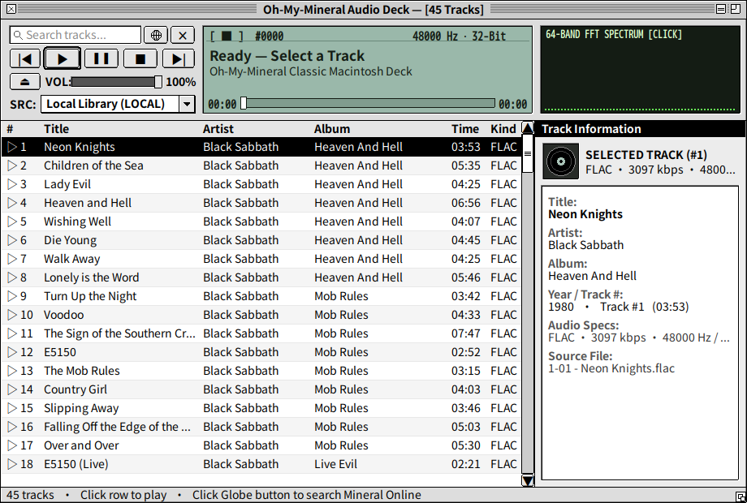
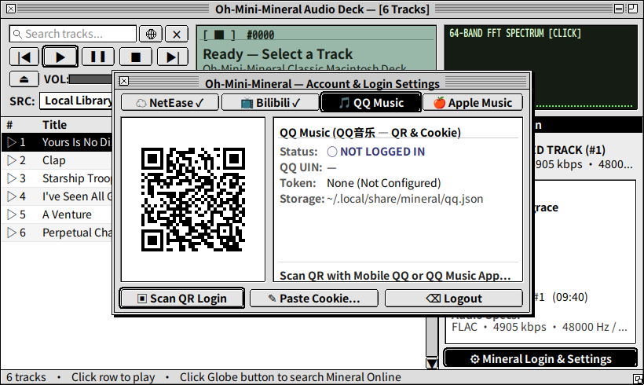
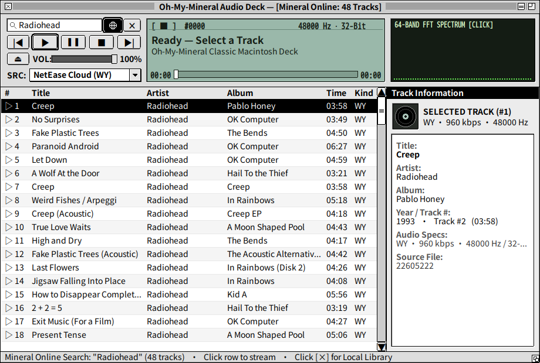
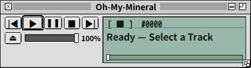

<div align="center">

# Oh-Mini-Mineral

**[Mineral](https://github.com/10knamesmore/Mineral) 的超轻量级复古 Macintosh System 7 桌面与微内核客户端（与 Qt 版 [Oh-My-Mineral](https://github.com/WeissHymmnos/Oh-My-Mineral) 并行开发）**

[](./LICENSE)
[](https://github.com/WeissHymmnos/Oh-Mini-Mineral/actions/workflows/release.yml)
[](https://github.com/WeissHymmnos/Oh-Mini-Mineral/releases)









</div>

## 特性

- **微内核守护进程 + 懒加载解码器池 (`omm_daemon`)** — 纯 Free Pascal 编写的音频微内核（体积仅 `~328 KB`，空闲内存 `~7.7 MB`），配备双槽 LRU 按需加载解码器池（`libcodec_*.so`，单插件仅 `~40 KB`），支持 MP3、FLAC、OGG/Opus、AAC/M4A、APE、WavPack、DSD (DSF/DFF)、Tracker (MOD/XM/IT) 及 WAV/AIFF 内核直通。
- **Classic Macintosh System 7 铂金复古界面 (`omm_gui`)** — 采用 Lazarus LCL (GTK2) 手绘经典 Mac OS System 7 细条纹标题栏、双环默认按钮、凹陷液晶屏（CRT 64 段实时频谱 / 示波器切换）与自适应多模式布局（全尺寸工作台 / 窄高列表 / 紧凑 MiniPlayer）。
- **Mineral 多源在线流媒体热插拔 (`libomm_mineral.so`)** — 完整对接原版 Mineral 在线音源协议（**网易云音乐**、**Bilibili 音频**、**QQ 音乐**、**Apple Music**、**AList / WebDAV**），支持首包 `32 KB` 渐进式边下边播，空闲自动卸载回收内存。
- **内置四平台扫码与 Cookie 登录配置** — 点击歌曲详情右下角扁平按钮 `⚙ Mineral Login & Settings` 即可直接在复古弹窗内扫码登录**网易云音乐**、**Bilibili**、**QQ 音乐**，或配置 **Apple Music** Token / 曲库地区（与原版 `~/.local/share/mineral/` 完全互通）。
- **无状态 60 FPS 终端客户端 (`omm_tui`)** — 通过 POSIX 共享内存 Seqlock (`omm_shm`) 与 Unix Domain Socket (`omm_ipc`) 零堆分配直连守护进程。

## 下载与安装 (Linux / macOS / Windows)

前往 **[GitHub Releases](https://github.com/WeissHymmnos/Oh-Mini-Mineral/releases)** 下载对应平台的安装包（与 Qt 版 `oh-my-mineral` 完全独立，可并存安装）：

- **Linux (RPM)**：`sudo rpm -Uvh oh-mini-mineral-0.1.0-1.x86_64.rpm`
- **Linux (DEB)**：`sudo apt install ./oh-mini-mineral_0.1.0-1_amd64.deb`
- **Linux (Portable Tarball)**：解压 `oh-mini-mineral-0.1.0-linux-x86_64.tar.gz`，运行 `./run.sh`
- **macOS (DMG)**：挂载 `Oh-Mini-Mineral-0.1.0-macOS.dmg`，将 `Oh-Mini-Mineral.app` 拖入 `Applications`（内置 Cocoa 原生 LCL 界面、CoreAudio `AudioToolbox` 硬件输出与 `.dylib` 解码器池）
- **Windows (x64 ZIP)**：解压 `Oh-Mini-Mineral-0.1.0-win64.zip`，双击运行 `Oh-Mini-Mineral.exe` 或 `omm_gui.exe`（内置 Win32/Win64 原生 LCL 界面、`winmm.dll` 硬件输出与 `.dll` 解码器池）

## 从源码构建与打包

```bash
# 构建全部组件 (libomm_mineral.{so,dylib,dll} + libcodec_*.{so,dylib,dll} + omm_daemon + omm_tui + omm_gui)
./scripts/build_all.sh all

# Linux: 生成 RPM / DEB / Tarball 发布包至 dist/
python3 ./scripts/package_release.py

# macOS: 生成 Oh-Mini-Mineral-0.1.0-macOS.dmg
./scripts/package_macos.sh 0.1.0

# Windows (PowerShell): 生成 Oh-Mini-Mineral-0.1.0-win64.zip
pwsh -File ./scripts/package_windows.ps1 0.1.0
```

运行客户端：

```bash
./bin/omm_daemon &
./bin/omm_gui
# 或启动终端 TUI：
./bin/omm_tui
```

## 许可证

本项目采用 [GNU Affero General Public License v3.0 (AGPL-3.0)](./LICENSE) 开源许可。
